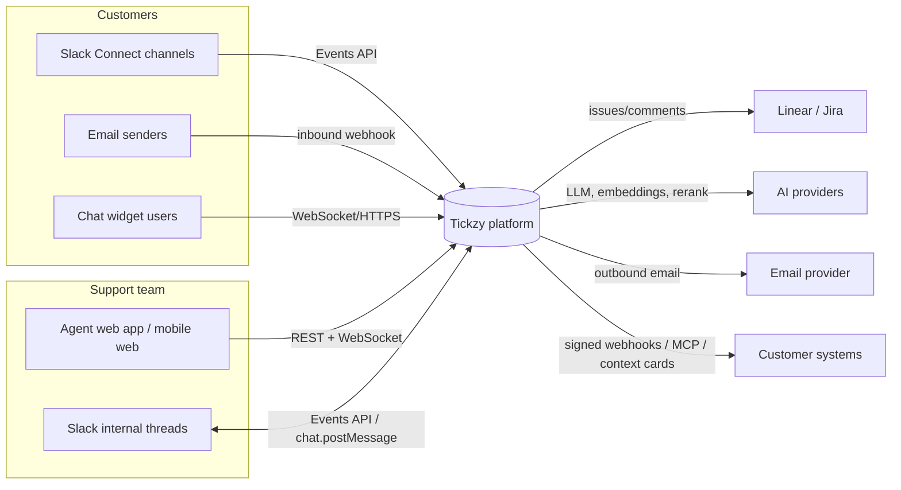
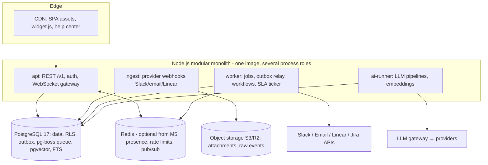
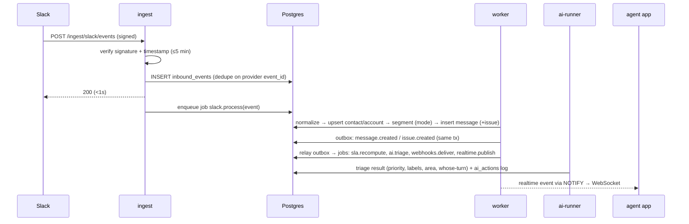

# Tickzy — Technical Architecture (v1.0, approved baseline)

- **Date:** 2026-11-19 · **Owner:** Principal Architect role · **Supersedes:** `docs/tickzy/recommended-architecture.md` (draft)
- **Constraints:** built by **one developer** first; must grow to a multi-region, SOC 2-ready SaaS without rewrites. Decisions are recorded in [`adr.md`](adr.md); data design in [`database.md`](database.md); costs in §11.
- **Inputs:** `docs/strategy/product-strategy.md`, `docs/research/architecture-research/saas-architecture.md`, `docs/research/technology-comparisons/technology-options.md`, `docs/research/ai-research/ai-architecture.md`, `docs/research/integration-research/communication-channels.md`.

## 1. Architecture principles
1. **One language, one repo, one database** until evidence forces otherwise (solo velocity; Intercom/Zendesk ran monoliths at huge scale [E: saas-architecture §1]).
2. **Tenant isolation is structural**: `workspace_id` on every tenant row + Postgres RLS + tenant-scoped repositories.
3. **Public API = product API**: the web app calls the same versioned REST endpoints third parties use.
4. **Persist first, process later**: every inbound event is stored durably before acknowledgement; all side effects run from a queue.
5. **Events everywhere**: state changes write domain events (transactional outbox) consumed by SLA, workflows, AI, webhooks, search, realtime.
6. **Boring infrastructure, swappable seams**: queue, LLM provider, email transport, storage, search behind small interfaces.
7. **Observability and audit by default**.

## 2. System context


## 3. Container view

- Process roles are the **same codebase** started with different entrypoints (`apps/server/src/main.ts --role=api|ingest|worker|ai`). Day one on a solo budget: `api+ingest` in one process, `worker+ai` in another.
- **Redis is deferred**: realtime fan-out uses Postgres `LISTEN/NOTIFY` per node until >1 API node or presence load demands Redis (ADR-008).

## 4. Code structure (monorepo)
```
tickzy/
├─ apps/
│  ├─ server/            # Fastify app: modules, process roles, migrations runner
│  ├─ web/               # Vite + React SPA (agent app, responsive/mobile)
│  └─ widget/            # (later) tiny chat widget bundle
├─ packages/
│  ├─ db/                # Drizzle schema, migrations, RLS helpers, test utils
│  ├─ shared/            # IDs, zod schemas (API contracts), errors, types
│  ├─ ui/                # (later) design-system components + tokens
│  └─ sdk/               # (later) generated TypeScript SDK from OpenAPI
├─ docs/ …
└─ .github/workflows/ci.yml
```
Server modules (`apps/server/src/modules/*`): `identity`, `workspaces`, `channels/{slack,email,widget}`, `conversations`, `issues`, `accounts`, `sla`, `routing`, `automation`, `ai`, `knowledge`, `integrations/{linear,jira}`, `analytics`, `webhooks`, `search`, `audit`, `realtime`. Rule: modules talk through **service interfaces and domain events**, never through each other's tables (enforced by lint import boundaries).

## 5. Request & data flows
### 5.1 Inbound Slack message → issue

### 5.2 Agent reply → Slack
Agent posts `POST /v1/issues/{id}/messages` → message row `delivery_state=pending` + outbox → worker `slack.deliver` (rate-limit budget per Slack workspace, retries with backoff honoring `Retry-After`) → store `external_id` → `delivery_state=sent` → realtime update. Failure after retries → `failed` + visible error with retry button.

### 5.3 SLA
On issue/message events the SLA module recomputes targets deterministically from the issue timeline + business schedules and stores `due_at`. A scanner job (every 15 s) selects `sla_targets where state='running' and due_at <= now()+warn_window` using an index and emits `sla.warning`/`sla.breached` once (idempotent state transitions). Semantics follow Plain's rules (ADR-011).

## 6. Multi-tenancy & security model
- **Tenant key:** `workspace_id` (ULID-prefixed `ws_…`). Every tenant table has it, composite indexes start with it.
- **RLS:** policies `USING (workspace_id = current_setting('app.workspace_id')::text)`; the app connects as role `tickzy_app` (NOBYPASSRLS); each request/job runs in a transaction that executes `SELECT set_config('app.workspace_id', $1, true)`. Migrations run as owner role. Cross-tenant platform jobs use a separate `tickzy_system` role with explicit, audited queries.
- **AuthN:** email magic link + Google/Microsoft OAuth (Better Auth library, sessions in Postgres, httpOnly SameSite=Lax cookies); API tokens (hashed, prefixed `tkz_live_`), scoped. SAML/SCIM via WorkOS at GA (ADR-006).
- **AuthZ:** role-based permission sets (`admin`, `agent`, `collaborator`, `viewer`, `integration`) → permission strings (`issues:write`, `settings:manage` …) checked in route preHandlers; agents (AI) are principals with roles too.
- **Secrets:** integration tokens encrypted with AES-256-GCM using a KMS-wrapped data key (envelope encryption); never logged.
- **Webhook security:** inbound signature verification for every provider; outbound HMAC-SHA256 `Tickzy-Signature: t=…,v1=…`; SSRF guard (deny private ranges) for all outbound customer URLs — `apps/server/src/lib/outbound/safe-fetch.ts` (T-111): resolve-then-pin, every DNS answer must be public, redirects re-checked, https only in production, size/time caps.
- **Audit log:** append-only `audit_log` for admin/data-access actions.
- **Slack data provenance:** `source` column on messages/chunks; training/export pipelines exclude `slack` (Slack ToS).

## 7. Real-time
WebSocket endpoint `/v1/realtime` (Fastify websocket). Client subscribes to topics (`workspace:{id}:inbox`, `issue:{id}`); server authorises per topic. Events are **invalidation/patch messages** (`{type:'issue.updated', id, version}`), client refetches via TanStack Query or applies patch. Cross-node fan-out: Postgres `NOTIFY tz_events` (payload ≤8 KB, ids only) → each API node forwards to its sockets. Presence/typing ("collision detection") in-memory per node in MVP; Redis when scaling out (ADR-008).

## 8. Automation engine (GA)
Workflow = versioned JSON definition `{trigger, conditions(tree), steps[]}`; steps: `set_field`, `assign`, `add_label`, `send_reply(template)`, `internal_note`, `webhook`, `wait(duration | until event)`, `ai_classify`, `ai_condition`. Executed by the worker as a durable state machine persisted in `workflow_runs/step_runs` on pg-boss (waits = scheduled jobs). Guarantees: one run per (workflow_version, event); loop guard (automation-originated events don't trigger same-trigger workflows; max chain depth 5); dry-run mode evaluates against past issues and returns would-be actions. MVP ships fixed built-in automations on the same engine.

## 9. AI infrastructure
- **LLM gateway** (`modules/ai/gateway`): `complete({route, messages, tools, schema})` → selects provider/model per route config, prompt caching, retries + fallback, token & cost metering into `ai_usage`, redaction hook, OpenTelemetry span. Providers: Anthropic (default), OpenAI (fallback); BYO key per workspace (v2).
- **Routes (initial):** `triage` (small model, structured output), `summary`, `draft_reply` (balanced model, citations), `segment_match`, `investigate` (advanced, tools; v2), `judge` (backtest grading).
- **Pipeline for drafts:** context builder (last 30 msgs, ≤2k chars each, account JSON) → query rewrite → hybrid retrieval (FTS + pgvector) → rerank (provider API) → generate with citations (structured output) → validator (citation coverage, no internal-only content in customer reply) → store `ai_drafts` + `ai_actions`.
- **Agent safety (GA customer agent):** Plain-style handoff policy as versioned config; budgets (6 steps, 45 s); shadow mode; risk-classed tools with approvals.
- **Knowledge index:** `knowledge_chunks(embedding vector(1024))` HNSW index, `tsvector` GIN; filtered by `workspace_id` + `visibility`. Embeddings via provider API (Voyage/OpenAI) behind interface; model name stored per chunk to allow re-embedding.
- Local dev & CI use a deterministic **fake provider** so tests never call paid APIs.

## 10. Performance & scalability targets
| Metric | MVP target | Design headroom |
|---|---|---|
| Slack → inbox visible | p95 < 5 s | queue autoscaling |
| API read p95 | < 150 ms | indexes, keyset pagination |
| Inbox list (500 issues) render | < 100 ms | virtualised list |
| Ingest throughput | 50 msg/s | 1k msg/s by adding worker roles |
| Tenants per DB | 1,000 small | move large tenants to dedicated cells (tenant directory) |
Scaling path: (1) vertical Postgres + read replica for analytics → (2) Redis + multiple API nodes → (3) partition `messages`/`issue_events` by time → (4) cells per region with tenant directory → (5) extract ingest/realtime services if needed.

## 11. Hosting, deployment & cost (solo stage)
| Component | Choice | Est. monthly (MVP) | Upgrade path |
|---|---|---|---|
| App (2 processes, US) | Fly.io machines (shared-cpu 1–2 GB) | ~$15–30 | dedicated CPU; EU region at GA |
| Static egress IP | Fly egress IPv4 (~$3.60/region) | ~$4 | per region |
| Postgres | Neon (Launch tier, pgvector, branching for previews) | ~$20–70 | RDS/Aurora or Crunchy when compliance/perf demands (ADR-004) |
| Object storage | Cloudflare R2 (no egress fees) | <$5 | — |
| Email | Postmark (inbound + outbound) | $15 | SES at volume |
| Errors/telemetry | Sentry (dev tier) + Grafana Cloud free | $0–26 | — |
| AI | Anthropic/OpenAI usage, Voyage embeddings | $20–100 (design partners) | BYO key, batch |
| Domain/CDN | Cloudflare | $0–20 | — |
| **Total** | | **≈ $100–270/mo** | |
Third-party prices are estimates (PARTIALLY VERIFIED: [Fly egress IPs](https://fly.io/docs/networking/egress-ips/), [QuotaGuard on Fly pricing](https://quotaguard.com/blog/fly-io-static-outbound-ip), [Neon vs RDS cost analysis](https://www.techplained.com/best-managed-postgres)). Everything is containerised (Dockerfile) so moving to AWS ECS + RDS (the long-term target in research) is a deployment change, not a rewrite.

**Deployment:** GitHub Actions CI (lint, typecheck, unit + integration tests against Postgres service container, build) → on `main`: build image → run migrations (`release_command`) → deploy roles. Preview environments per PR using Neon branches (later). Feature flags via `workspace_flags` table.

## 12. Observability
Structured JSON logs (pino) with `request_id`, `workspace_id`, `principal_id`; OpenTelemetry traces (HTTP, DB, jobs, LLM spans with tokens/cost); Sentry for errors (web + server); health endpoints `/healthz` (liveness) and `/readyz` (DB + migrations); SLO dashboards for ingestion latency, delivery success, SLA scanner lag, job queue depth.

## 13. Testing strategy (summary — full in blueprint)
Unit (Vitest) for pure logic (SLA math, segmentation, permissions); integration tests against a real Postgres (per-test schema/transaction) including **RLS isolation tests**; contract tests generated from OpenAPI; E2E (Playwright) for critical flows at M3+; provider fakes for Slack/email/LLM; load test of ingestion before design partners.
