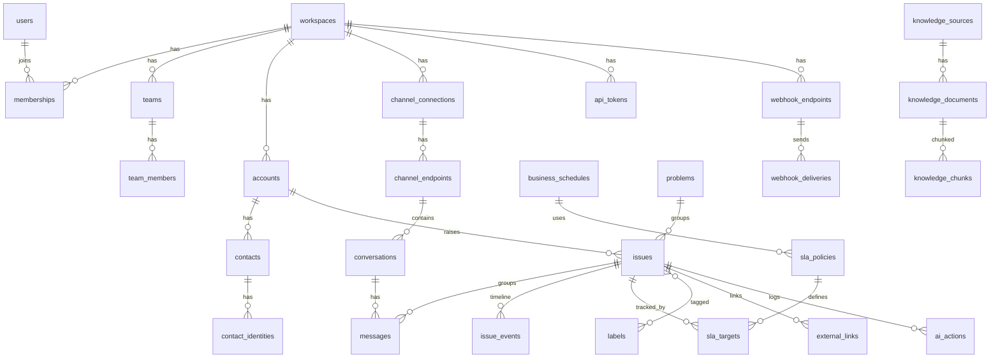

# Database Design (PostgreSQL) — v1.0

- **Conventions:** snake_case; PK `id text` = prefixed ULID (ADR-018); every tenant table has `workspace_id text not null references workspaces(id)` and RLS enabled; timestamps `timestamptz not null default now()`; soft delete via `deleted_at` where user-deletable; JSONB only for genuinely schemaless data (custom field values, workflow definitions, raw payloads).
- **RLS policy template:** `CREATE POLICY tenant_isolation ON <t> USING (workspace_id = current_setting('app.workspace_id', true)) WITH CHECK (workspace_id = current_setting('app.workspace_id', true));` + `ALTER TABLE <t> ENABLE ROW LEVEL SECURITY; ALTER TABLE <t> FORCE ROW LEVEL SECURITY;`
- **Roles:** `tickzy_owner` (migrations), `tickzy_app` (NOBYPASSRLS, runtime), `tickzy_system` (BYPASSRLS, audited platform jobs only).

## 1. ERD (core)

## 2. Tables (MVP)
### Identity & workspace (M0)
| Table | Key columns | Notes |
|---|---|---|
| `users` (global) | id `usr_`, email citext unique, name, avatar_url, created_at | no RLS (global identity); access via memberships |
| `workspaces` (global) | id `ws_`, name, slug unique, issue_prefix (e.g., `TKZ`), region, plan, created_at | tenant root; RLS on `id = app.workspace_id` |
| `memberships` | workspace_id, user_id, role enum(`admin`,`agent`,`collaborator`,`viewer`), status, created_at; unique(workspace_id,user_id) | |
| `sessions`, `auth_accounts`, `verifications` | per Better Auth schema | global |
| `api_tokens` | id `tok_`, workspace_id, name, token_hash (sha256), prefix, scopes text[], last_used_at, revoked_at | token shown once |
| `audit_log` | id `aud_`, workspace_id, actor_type, actor_id, action, target_type, target_id, metadata jsonb, ip, created_at | append-only (no UPDATE/DELETE grant) |
| `workspace_counters` | workspace_id, name, value bigint | issue numbers via `UPDATE … RETURNING` |
| `outbox` | id bigserial, workspace_id, type, payload jsonb, created_at, published_at | relay → pg-boss |
| `inbound_events` | id `evt_`, workspace_id null, provider, provider_event_id, payload jsonb, received_at, processed_at, error; unique(provider, provider_event_id) | dedupe; workspace resolved later |

### Customers (M2)
| `accounts` | id `acc_`, workspace_id, name, domain citext, tier, owner_member_id, external_ids jsonb, custom jsonb, created_at | idx (workspace_id, domain) |
| `contacts` | id `con_`, workspace_id, account_id null, name, email citext, role_in_account, created_at | |
| `contact_identities` | id, workspace_id, contact_id, kind enum(email,slack,teams,widget), external_key text; unique(workspace_id,kind,external_key) | slack key = `team_id:user_id` |

### Channels & conversations (M1–M2)
| `channel_connections` | id `chc_`, workspace_id, kind(slack,email,widget,linear,jira), external_tenant_id (Slack team_id), credentials_enc bytea, status, settings jsonb | tokens encrypted |
| `channel_endpoints` | id `che_`, workspace_id, connection_id, kind(slack_channel,email_address,widget), external_id (Slack channel id / address), name, endpoint_type(customer,community,internal,triage), default_account_id, ingestion_mode enum(time,ai,thread,emoji), settings jsonb | |
| `conversations` | id `cnv_`, workspace_id, endpoint_id, external_thread_key (Slack thread_ts / email root Message-ID), last_message_at | |
| `messages` | id `msg_`, workspace_id, conversation_id, issue_id null, direction(in,out), visibility(public,internal), author_type(contact,member,ai,system), author_id, body_ast jsonb, body_text text, source(slack,email,widget,api,ui), external_id, delivery_state(pending,sent,failed,received), raw_ref (object key), created_at, edited_at, deleted_at, search tsvector generated | idx (workspace_id, issue_id, created_at); GIN(search) |
| `attachments` | id `att_`, workspace_id, message_id, object_key, filename, mime, size, scan_state | |

### Issues (M1–M3)
| `issues` | id `iss_`, workspace_id, number int, title, status_category enum(`triage`,`waiting_on_us`,`waiting_on_customer`,`blocked`,`resolved`,`closed`,`ignored`), status_id (custom), priority enum(urgent,high,normal,low), assignee_principal_id, team_id, account_id, requester_contact_id, channel_kind, product_area, problem_id, custom jsonb, first_response_at, resolved_at, last_customer_message_at, last_team_message_at, created_at, updated_at, version int | unique(workspace_id,number); idx (workspace_id,status_category,updated_at) |
| `issue_events` | id bigserial, workspace_id, issue_id, type, actor_type, actor_id, data jsonb, created_at | append-only timeline |
| `issue_labels` / `labels` | label: id, workspace_id, name, color, description, parent_id, ai_enabled | |
| `statuses` | id, workspace_id, category, name, position, archived | custom statuses inside categories |
| `teams`, `team_members` | round-robin pointer on team | |
| `custom_field_defs` | id, workspace_id, entity(issue,account,contact), key, type, options jsonb, required | |
| `external_links` | id, workspace_id, issue_id, provider(linear,jira,github), external_id, url, title, status, synced_at | |
| `problems` (GA) | id `prb_`, workspace_id, title, status, external_link_id | |

### SLA (M3)
| `business_schedules` | id, workspace_id, name, timezone, weekly_hours jsonb, holidays jsonb |
| `sla_policies` | id, workspace_id, name, conditions jsonb, targets jsonb (metric, minutes, schedule_ids), pause_categories text[], position, enabled |
| `sla_targets` | id, workspace_id, issue_id, policy_id, metric(first_response,next_response,follow_up,resolution), state(running,paused,achieved,breached,canceled), started_at, due_at, consumed_ms, warned_at, finished_at; idx (state, due_at) where state='running' |

### AI & knowledge (M4)
| `ai_actions` | id `aia_`, workspace_id, issue_id, route, kind(triage,draft,summary,segment), input_ref, output jsonb, sources jsonb, model, tokens_in, tokens_out, cost_usd numeric(10,5), latency_ms, accepted bool null, created_at |
| `ai_usage_daily` | workspace_id, day, route, tokens, cost_usd |
| `knowledge_sources` | id, workspace_id, kind(url_crawl,manual,issue_history), config, status, visibility(public,internal) |
| `knowledge_documents` | id, workspace_id, source_id, title, url, content_hash, updated_at |
| `knowledge_chunks` | id, workspace_id, document_id, ordinal, text, tsv tsvector, embedding vector(1024), embed_model, visibility, source_provenance | HNSW(embedding vector_cosine_ops); GIN(tsv) |

### Platform (M5)
| `webhook_endpoints` | id, workspace_id, url, secret_enc, event_types text[], enabled, failure_count |
| `webhook_deliveries` | id, workspace_id, endpoint_id, event_id, attempt, status, response_code, next_attempt_at |
| `workflows`, `workflow_versions`, `workflow_runs`, `step_runs` (GA) | |

## 3. Indexing & partitioning plan
- All lookups begin with `workspace_id`. Keyset pagination on `(workspace_id, updated_at, id)`.
- `messages` and `issue_events` partitioned by month (declarative) once > ~50M rows.
- Analytics via rollup tables refreshed by jobs (`metrics_daily`), never heavy queries on hot tables in request path.

## 4. Data lifecycle
Retention settings per workspace (messages, attachments, raw events: default raw 30 days); GDPR erasure job (contact → redact messages, delete identities); export job (JSON/CSV per workspace, excluding raw Slack payloads beyond what is the customer's own records — legal review).
