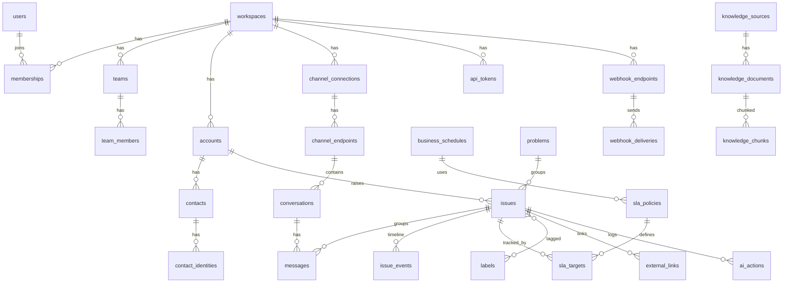

# Database Design (PostgreSQL) — v1.0

- **Conventions:** snake_case; PK `id text` = prefixed ULID (ADR-018); every tenant table has `workspace_id text not null references workspaces(id)` and RLS enabled; timestamps `timestamptz not null default now()`; soft delete via `deleted_at` where user-deletable; JSONB only for genuinely schemaless data (custom field values, workflow definitions, raw payloads).
- **RLS policy template:** `CREATE POLICY tenant_isolation ON <t> USING (workspace_id = current_setting('app.workspace_id', true)) WITH CHECK (workspace_id = current_setting('app.workspace_id', true));` + `ALTER TABLE <t> ENABLE ROW LEVEL SECURITY; ALTER TABLE <t> FORCE ROW LEVEL SECURITY;`
- **Cross-table references** between tenant tables are composite foreign keys `(workspace_id, x_id) → x (workspace_id, id)` (ADR-025): FK checks bypass RLS, so a plain FK could point across workspaces.
- **Roles:** `tickzy_owner` (migrations; needs CREATEROLE and must be able to act as `tickzy_app` — the runner grants itself membership, ADR-025), `tickzy_app` (NOBYPASSRLS, runtime), `tickzy_system` (BYPASSRLS, audited platform jobs only).

## 1. ERD (core)

## 2. Tables (MVP)
### Identity & workspace (M0)
| Table | Key columns | Notes |
|---|---|---|
| `users` (global) | id `usr_`, email citext unique, name, avatar_url, created_at | no RLS (global identity); access via memberships |
| `workspaces` (global) | id `ws_`, name, slug unique, issue_prefix (e.g., `TKZ`), region, plan, created_at | tenant root; RLS on `id = app.workspace_id` |
| `memberships` | workspace_id, user_id, role enum(`admin`,`agent`,`collaborator`,`viewer`), status, created_at; unique(workspace_id,user_id) | |
| `sessions`, `login_tokens` (migration 0003, ADR-021) | sessions: id (public half), user_id, secret_hash sha256, expires_at, last_used_at; login_tokens: id, email, secret_hash, expires_at, used_at | global; RLS forced with **no grants** — reachable only via `auth_*` SECURITY DEFINER functions |
| `user_identities` (migration 0006, ADR-024) | id `idn_`, user_id, provider (`google`/`microsoft`), subject (Google `sub`; Microsoft `tid:oid`), email_at_link, created_at, last_used_at; unique (provider, subject) | global; RLS forced, no grants — only `auth_oauth_sign_in()`; never keyed on email |
| `invitations` (migration 0004, T-102) | id `inv_`, workspace_id, email citext, role, token_id unique, secret_hash sha256, invited_by, expires_at (7 d), accepted_at/by, revoked_at; unique pending (workspace_id, email) | tenant RLS; public preview and accept only via `invitation_preview()` / `accept_invitation()` (token is the capability; accept checks the signed-in email) |
| `api_tokens` (migration 0005, ADR-022) | id `tok_`, workspace_id, name, token_id unique (public half; prefix shown), secret_hash sha256, scopes text[] (CHECK: non-empty, never `developers:manage`), created_by, expires_at, last_used_at, revoked_at | token shown once; tenant RLS; UPDATE only on `revoked_at`/`name`; bearer lookup via `api_token_lookup()` |
| `audit_log` | id `aud_`, workspace_id, actor_type, actor_id, action, target_type, target_id, metadata jsonb, ip, created_at | append-only (no UPDATE/DELETE grant) |
| `workspace_counters` | workspace_id, name, value bigint | issue numbers via `UPDATE … RETURNING` |
| `outbox` | id bigserial, workspace_id, type, payload jsonb, created_at, published_at | relay → pg-boss |
| `inbound_events` | id `evt_`, workspace_id null, provider, provider_event_id, payload jsonb, received_at, processed_at, error; unique(provider, provider_event_id) | dedupe; workspace resolved later |

### Customers (M2)
| `accounts` (0007) | id `acc_`, workspace_id, name, tier, owner_membership_id, external_ids jsonb, custom jsonb, created_at, updated_at, deleted_at | soft delete; idx (workspace_id, lower(name)) |
| `account_domains` (0007) | (workspace_id, domain citext) PK, account_id | one account per domain per workspace — email-domain auto-mapping (FR-4.2) |
| `contacts` (0007, 0009) | id `con_`, workspace_id, account_id null (SET NULL when the account is deleted), account_source (`auto` \| `manual` — automation never overrides manual), name, role_in_account, custom jsonb, created_at, updated_at, deleted_at | emails live in `contact_identities` |
| `contact_identities` (0007) | id `cid_`, workspace_id, contact_id, kind (email, slack, teams, widget), external_key; unique (workspace_id, kind, external_key) | email keys lowercase (CHECK); slack key = `team_id:user_id` |

### Channels & conversations (M1–M2)
| `channel_connections` | id `chc_`, workspace_id, kind(slack,email,widget,linear,jira), external_tenant_id (Slack team_id), credentials_enc bytea, status, settings jsonb | tokens encrypted |
| `channel_endpoints` | id `che_`, workspace_id, connection_id, kind(slack_channel,email_address,widget), external_id (Slack channel id / address), name, endpoint_type(customer,community,internal,triage), default_account_id, ingestion_mode enum(time,ai,thread,emoji), settings jsonb | |
| `conversations` (0008) | id `cnv_`, workspace_id, channel_kind (slack, email, widget, api, ui), endpoint_id (FK added with `channel_endpoints`, T-301; NULL for api/ui), external_thread_key (Slack thread_ts / email root Message-ID), last_message_at; unique thread per endpoint | |
| `messages` (0008) | id `msg_`, workspace_id, conversation_id, issue_id null, direction(in,out), visibility(public,internal), author_type(contact,member,ai,system), author_id, body_ast jsonb, body_text text, source(slack,email,widget,api,ui), external_id, delivery_state(pending,sent,failed,received), created_at, edited_at, deleted_at, search tsvector generated (`simple` config) | CHECKs: inbound ⇔ contact author, inbound is public + received; **internal notes have no delivery_state** (can never be sent, FR-3.5); unique (workspace_id, source, external_id) dedupe; idx (workspace_id, issue_id, created_at); GIN(search); `raw_ref` added with ingestion (T-301) |
| `attachments` (0008) | id `att_`, workspace_id, message_id, object_key, filename, mime, size, scan_state (pending, clean, infected, error) | |

### Issues (M1–M3)
| `issues` (0008) | id `iss_`, workspace_id, number int (`next_issue_number()`: row-locked counter, unique and gap-free), title, status_category, status_id (composite FK to `statuses (workspace_id, id, category)` — status always matches its category), priority (urgent, high, normal, low), assignee_membership_id (AI/agent assignee added with M5), team_id, account_id, requester_contact_id, channel_kind, product_area, custom jsonb, first_response_at, resolved_at, closed_at, last_customer_message_at, last_team_message_at, created_at, updated_at, version int (optimistic concurrency) | unique(workspace_id,number); idx (workspace_id, status_category, updated_at, id); `problem_id` added with problems (GA) |
| `issue_events` (0008) | id bigserial, workspace_id, issue_id, type (`dotted.name`), actor_type (user, api_token, system, ai, contact), actor_id, data jsonb, created_at | append-only (SELECT/INSERT grants only) |
| `issue_labels` (0008) / `labels` | label (0007): id `lbl_`, workspace_id, name, color `#rrggbb`, description, parent_id (same workspace), ai_enabled, archived_at; unique name per parent (case-insensitive) | `issue_labels` with issues (T-202) |
| `statuses` (0007) | id `sts_`, workspace_id, category (7 FR-3.1 categories), name, position, is_default, archived_at; one default per category; unique name | seeded by `seed_workspace_defaults()` |
| `teams`, `team_members` (0007) | team: id `tm_`, name, assignment_strategy (manual, round_robin), round_robin_cursor, archived_at; member: (team_id, membership_id) | |
| `custom_field_defs` (0007) | id `cfd_`, workspace_id, entity (issue, account, contact), key `^[a-z][a-z0-9_]{0,39}$` (never reused), label, type (text, number, boolean, date, select, multi_select, url), options (select types only), required, position, archived_at | values in the entity's `custom` jsonb, validated by the API |
| `saved_views` (0012) | id `vw_`, workspace_id, owner_user_id, shared bool, name (1–60; unique per owner for personal, per workspace for shared, case-insensitive), base (system view id), filters jsonb (priority, channel, team, label, account, q — the inbox URL state; ≤2 KB), sort, position | RLS policy = tenant isolation **and** visibility (`shared OR owner_user_id = app_user_id()`), so personal views are private at the database level |
| `external_links` | id, workspace_id, issue_id, provider(linear,jira,github), external_id, url, title, status, synced_at | |
| `problems` (GA) | id `prb_`, workspace_id, title, status, external_link_id | |

### SLA (M3)
| `business_schedules` | id, workspace_id, name, timezone, weekly_hours jsonb, holidays jsonb |
| `sla_policies` | id, workspace_id, name, conditions jsonb, targets jsonb (metric, minutes, schedule_ids), pause_categories text[], position, enabled |
| `sla_targets` | id, workspace_id, issue_id, policy_id, metric(first_response,next_response,follow_up,resolution), state(running,paused,achieved,breached,canceled), started_at, due_at, consumed_ms, warned_at, finished_at; idx (state, due_at) where state='running' |

### AI & knowledge (M4)
| `ai_actions` | id `aia_`, workspace_id, issue_id, route, kind(triage,draft,summary,segment), input_ref, output jsonb, sources jsonb, model, tokens_in, tokens_out, cost_usd numeric(10,5), latency_ms, accepted bool null, created_at |
| `ai_usage_daily` | workspace_id, day, route, tokens, cost_usd |
| `knowledge_sources` | id, workspace_id, kind(url_crawl,manual,issue_history), config, status, visibility(public,internal) |
| `knowledge_documents` | id, workspace_id, source_id, title, url, content_hash, updated_at |
| `knowledge_chunks` | id, workspace_id, document_id, ordinal, text, tsv tsvector, embedding vector(1024), embed_model, visibility, source_provenance | HNSW(embedding vector_cosine_ops); GIN(tsv) |

### Platform (M5)
| `webhook_endpoints` | id, workspace_id, url, secret_enc, event_types text[], enabled, failure_count |
| `webhook_deliveries` | id, workspace_id, endpoint_id, event_id, attempt, status, response_code, next_attempt_at |
| `workflows`, `workflow_versions`, `workflow_runs`, `step_runs` (GA) | |

## 3. Indexing & partitioning plan
- All lookups begin with `workspace_id`. Keyset pagination on `(workspace_id, updated_at, id)`.
- `messages` and `issue_events` partitioned by month (declarative) once > ~50M rows.
- Analytics via rollup tables refreshed by jobs (`metrics_daily`), never heavy queries on hot tables in request path.

## 4. Data lifecycle
Retention settings per workspace (messages, attachments, raw events: default raw 30 days); GDPR erasure job (contact → redact messages, delete identities); export job (JSON/CSV per workspace, excluding raw Slack payloads beyond what is the customer's own records — legal review).
