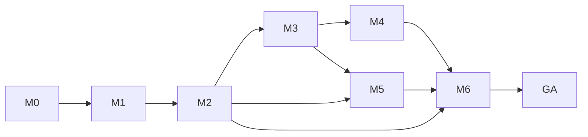

# Development Backlog — Phases, Milestones, Epics, Tasks

- **Date:** 2026-11-19. Each task: **ID · Priority (P0/P1/P2) · Complexity (S ≤½ day, M ≤2 days, L ≤5 days) · Depends · Outcome · Acceptance criteria (AC) · Tests**. Status lives in `docs/roadmap/development-checklist.md` and `CURRENT-STATE.md`.
- Rule for coding agents: implement tasks in ID order within a milestone unless dependencies allow parallelism; never start a task whose dependencies are not ✅.

## Phase A — MVP (design-partner release)

### M0 · Foundations (Epic E0)
| ID | Pri | Cx | Depends | Outcome | AC | Tests |
|---|---|---|---|---|---|---|
| T-001 | P0 | S | — | pnpm monorepo (`apps/*`, `packages/*`), TypeScript strict, ESLint (flat) + Prettier, Vitest workspace | `pnpm install && pnpm typecheck && pnpm lint && pnpm test` succeed from root | CI runs all |
| T-002 | P0 | S | T-001 | `packages/shared`: prefixed ULID ids (`newId('ws')`, `isId`, `parseId`), error types, base zod schemas | ids sortable by time, 26-char ULID, validated prefix list | unit: format, monotonic ordering, invalid prefix rejected |
| T-003 | P0 | M | T-001 | `packages/db`: Drizzle schema for `users`, `workspaces`, `memberships`, `workspace_counters`, `audit_log`, `outbox`; SQL migrations incl. roles (`tickzy_app` NOBYPASSRLS) and RLS policies; migrate script | migrations apply on empty DB idempotently; RLS enabled+forced on tenant tables | integration: migrate up on fresh DB |
| T-004 | P0 | M | T-003 | `withWorkspace(db, wsId, fn)` transaction helper setting `app.workspace_id`; system helper for platform ops | queries inside helper see only that tenant; outside helper tenant tables return 0 rows for app role | **RLS isolation suite** (read/insert/update/delete cross-tenant all denied) |
| T-005 | P0 | M | T-002 | `apps/server`: Fastify 5 app factory, config (zod env), pino logging with request_id, error envelope, `/healthz` `/readyz`, graceful shutdown | unknown route → 404 envelope; validation error → 422 envelope; readyz checks DB | integration via `app.inject` |
| T-006 | P0 | S | T-005 | Dev authentication shim: `Authorization: Bearer dev_<userId>` accepted only when `AUTH_DEV_MODE=true` (replaced by T-101) | disabled by default; startup refuses dev mode in production | unit + integration |
| T-007 | P0 | M | T-004,T-005 | Workspaces module: `POST /v1/workspaces`, `GET/PATCH /v1/workspaces/current`; creator becomes admin; audit entries; issue prefix validation | AC of FR-1.1; slug unique (409 on conflict) | integration incl. permission (agent cannot PATCH) |
| T-008 | P0 | S | T-007 | Permission model (`roles → permissions`), `requirePermission()` preHandler, matrix per api-spec §2 | table-driven; 403 envelope | unit matrix tests |
| T-009 | P0 | M | T-003 | Outbox writer + relay to pg-boss; `JobQueue` interface; worker process role | event written in same tx as change; relay marks published; jobs retried | integration: tx rollback → no event; relay idempotent |
| T-010 | P0 | M | T-001 | `apps/web`: Vite + React 19 + TanStack Router/Query + Tailwind v4 tokens (light/dark from UX spec), app shell (sidebar / icon rail / bottom tabs responsive), theme toggle persisted | renders at 390/768/1280 widths; theme persists; axe no serious violations | Vitest + Testing Library; Playwright smoke later |
| T-011 | P0 | S | T-001..T-005 | GitHub Actions CI: install, lint, typecheck, test with Postgres 16 service | CI green on PR | ✅ first GitHub run green 2026-11-23 (push to main, run #1) |
| T-012 | P0 | S | T-005 | OpenAPI generation at `/v1/openapi.json` from route schemas | document validates as OpenAPI 3.1 | test: endpoints present |

### M1 · Identity & access (Epic E1)
| T-101 | P0 | L | T-007 | Auth core (ADR-021): sessions (hashed tokens, sliding expiry, revocation), magic links (single-use, 15 min, no enumeration, per-email limit), CSRF Origin checks; email transport interface (console in dev, Postmark at T-303) | FR-1.2 AC | integration with memory email transport ✅ done 2026-11-23 |
| T-101b | P0 | M | T-101 | Google & Microsoft sign-in via a certified OIDC client library (PKCE, state, nonce); account linking by verified email | FR-1.2 AC | integration with mocked IdP ✅ done 2026-11-23 (ADR-024; 13 server, 4 web, browser E2E 15/15 with mock provider; real-provider check pending OAuth apps) |
| T-102 | P0 | M | T-101,T-008 | Invitations & membership management API + UI | FR-1.3 | integration + UI tests ✅ done 2026-11-23 (18 server, 10 web, real-stack E2E 23/23) |
| T-103 | P0 | M | T-008 | API tokens (hash, prefix, scopes, revoke) + bearer auth | FR-1.6 | integration ✅ done 2026-11-23 (12 server, 5 web, real-stack E2E 18/18) |
| T-104 | P0 | S | T-007 | Audit log API `GET /v1/audit-log` with filters | FR-1.7 | integration |
| T-105 | P0 | M | T-010,T-101 | Web: sign-in, onboarding step 1 (create workspace), current workspace, sign-out (settings › members moved to T-102) | UX S11 step 1 | Playwright smoke ✅ done 2026-11-23 |
| T-106 | P0 | S | T-005 | Rate limiting (per token/IP, Postgres-backed counter or in-memory per node) | 429 envelope + headers | integration ✅ done 2026-11-23 (in-memory per node, ADR-023; 9 server tests + 1 web) |

### M2 · Core inbox (Epics E2 accounts, E3 issues, E4 realtime)
| T-201 | P0 | M | T-004 | Schema: accounts, contacts, contact_identities, teams, statuses, labels, custom_field_defs | migrations + RLS | isolation suite extended ✅ done 2026-11-23 (migration 0007, ADR-025; 11 db tests + non-superuser migration test) |
| T-202 | P0 | L | T-201 | Schema + domain: conversations, messages, issues, issue_events, attachments; issue number allocation | FR-3.1 lifecycle rules as pure functions | unit: state machine table; integration ✅ done 2026-11-23 (migration 0008; lifecycle in `@tickzy/shared`, 30 state-machine/timestamp tests; 12 integration tests) |
| T-203 | P0 | M | T-202 | Accounts & contacts API + identity resolution service | FR-4.1, FR-4.2 | integration ✅ done 2026-11-23 (18 integration + 3 custom-field + 2 domain unit tests; Slack-team mapping arrives with T-301) |
| T-204 | P0 | L | T-202 | Issues API (list filters/sort/keyset, get by key, patch, timeline) | api-spec §1 | contract + integration |
| T-205 | P0 | M | T-204 | Messages API (reply/note) with delivery abstraction (no channel yet → `api` source) | internal notes never delivered externally | integration |
| T-206 | P0 | M | T-202 | Whose-turn status automation & reopen rules | FR-3.2 | unit + integration |
| T-207 | P0 | M | T-204 | Search (tsvector + operators parser) | FR-3.8 | unit parser; integration; benchmark script |
| T-208 | P0 | M | T-009 | Realtime gateway (WS, topic auth, NOTIFY fan-out) + presence | FR-3.9 | integration with ws client |
| T-209 | P0 | L | T-010,T-204 | Web inbox: queue (virtualised, views, filters), conversation, details pane, composer, shortcuts, palette, mobile single-pane | UX S2; works at 390px | component tests; Playwright W1 (API-created issue) |
| T-210 | P0 | M | T-209 | Accounts list/profile UI | UX S4 | component tests |
| T-211 | P0 | S | T-204 | Saved views API + UI | FR-3.7 | integration |

### M3 · Channels (Epics E5 email, E6 Slack, E7 widget)
| T-301 | P0 | M | T-202 | Channel adapter interface + inbound_events table + ingest process role | persist-before-ack; dedupe | integration |
| T-302 | P0 | L | T-301 | Email inbound (Postmark webhook): parse, thread, strip quotes, attachments → R2, auto-reply detection | FR-2.7 | fixture corpus tests (≥20 real-world samples) |
| T-303 | P0 | M | T-302 | Email outbound: domain verification (DKIM/Return-Path), send replies with threading headers, bounce webhook | FR-2.7 | integration with fake transport |
| T-304 | P0 | L | T-301 | Slack OAuth install, token encryption, channel listing & endpoint config | FR-2.1 | integration with Slack fake |
| T-305 | P0 | L | T-304 | Slack events ingestion + ingestion modes (time, thread, emoji) + identity mapping | FR-2.2, FR-2.3 | unit segmentation table; replay fixtures |
| T-306 | P0 | M | T-305 | Slack outbound delivery (bot/as-user), rate-limit budget, retries | FR-2.4 | integration |
| T-307 | P0 | M | T-305 | Internal triage threads sync | FR-2.5 | integration |
| T-308 | P0 | L | T-301 | Chat widget (separate bundle, identity verification, WS) | FR-2.8 | Playwright |
| T-309 | P0 | M | T-305,T-302 | Onboarding steps 2–3 (connect Slack, email) UI | UX S11 | Playwright |
| T-310 | P0 | S | T-305 | Slack Marketplace submission package (scopes justification, privacy, security answers) | doc ready | — |

### M4 · SLA, routing, analytics (Epics E8, E9)
| T-401 | P0 | L | T-202 | SLA engine pure functions (schedules, holidays, pause, multi-schedule) | ADR-011 semantics | property-based tests |
| T-402 | P0 | M | T-401,T-009 | SLA persistence, recompute on events, scanner job, notifications | FR-5.4 | integration with fake clock |
| T-403 | P0 | M | T-402 | SLA & business-hours settings UI + preview | UX S10 | component tests |
| T-404 | P0 | M | T-204 | Teams & round-robin assignment; built-in automations (auto-assign, auto-close 7d) | FR-3.4, FR-6 MVP | integration |
| T-405 | P0 | M | T-402 | Metrics rollups + `/v1/analytics/overview` | FR-10.1 definitions documented | SQL fixture tests |
| T-406 | P0 | M | T-405,T-209 | Overview dashboard UI (desktop + mobile) | UX S1 | component tests |

### M5 · AI copilot & knowledge (Epics E10, E11)
| T-501 | P0 | M | T-009 | LLM gateway (routes, provider adapters Anthropic/OpenAI, fake provider, metering, spend cap) | ADR-013 | unit with fake; cost accounting tests |
| T-502 | P0 | M | T-501,T-202 | AI triage job (title, priority rubric, labels, area) + ai_actions log | FR-7.1 | golden-set eval (fake + recorded) |
| T-503 | P0 | M | T-501 | Summaries | FR-7.2 | |
| T-504 | P0 | L | T-201 | Knowledge sources: URL crawler (sitemap, robots), chunking, embeddings, pgvector (requires pgvector-enabled Postgres) | FR-8.1 | integration (pgvector in CI image) |
| T-505 | P0 | L | T-504,T-501 | Hybrid retrieval + rerank + draft replies with citations + validator | FR-7.3, FR-8.2 | retrieval eval; validator unit tests |
| T-506 | P0 | M | T-505 | Similar issues | FR-7.4 | |
| T-507 | P0 | M | T-502,T-209 | AI UI: suggestion card, AI log tab, settings (toggles, cap) | UX S2/S6 | component tests |
| T-508 | P0 | L | T-505 | Customer agent shadow mode (would-have-replied entries, handoff policy config) | FR-7.7 (shadow) | scenario tests |

### M6 · Engineering loop, developer platform, hardening (Epics E12–E14)
| T-601 | P0 | L | T-204 | Linear integration (OAuth, create/link, webhook status sync → Blocked / close-the-loop) | FR-9.1 | integration with fake |
| T-602 | P0 | L | T-601 | Jira Cloud integration (same contract) | FR-9.1 | |
| T-603 | P0 | M | T-009 | Outbound webhooks (catalogue, signing, retries, delivery log, replay) | FR-11.2 | integration |
| T-604 | P0 | M | all | Security hardening pass (SEC-1…14), dependency scan, pen-test checklist | checklist complete | security tests |
| T-605 | P0 | M | all | Load test ingestion (k6), SLOs & dashboards, alerting | NFR-1/2 met | load report |
| T-606 | P0 | M | all | Deploy pipeline (Fly.io + Neon), backups/restore drill, runbooks | restore tested | drill log |
| T-607 | P0 | S | all | Design-partner onboarding kit & feedback loop | 5 partners live | — |

## Phase B — GA (P1, summarised epics)
E20 Customer agent live + approvals + budgets · E21 Backtests & QA rubrics · E22 Knowledge gaps & help center · E23 Workflows builder v1 (versioning, dry-run) · E24 Problems & broadcasts · E25 Portal · E26 SAML SSO (WorkOS) · E27 HubSpot/Salesforce · E28 Importers (Zendesk, Intercom, Pylon, Plain) · E29 Billing & metering (Stripe) · E30 EU region cell · E31 MCP server, context cards, TS SDK · E32 Slack Marketplace listing · E33 SOC 2 Type I · E34 Merge/split, bulk actions, emoji actions, edit/delete sync, AI segmentation mode.

## Phase C — v2 (P2)
Teams, Discord, SCIM, custom roles, skills/capacity/pull routing, account signals, investigative copilot (MCP connectors), warehouse sync, AI QA of all conversations, BYO LLM key, Fin compatibility, mobile PWA push.

## Dependency graph (milestones)

