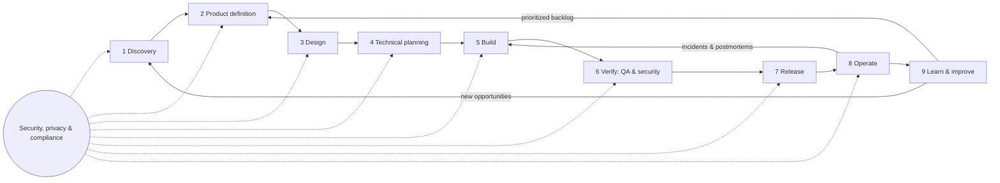

# Tickzy Development Pipeline (Product & Software Development Lifecycle)

- **Status:** ADOPTED — this is the process Tickzy follows. `CLAUDE.md` makes it binding for coding agents.
- **Date:** 2026-11-23 · **Owner:** founder (acting PM, designer, architect, engineer, SRE) with AI coding agents.
- **Companion files:** [`pipeline-checklist.md`](pipeline-checklist.md) (live status per stage) · [`engineering-workflow.md`](engineering-workflow.md) (the per-task loop and Definition of Done).
- **Origin:** a generic SaaS pipeline (idea → retirement) supplied by the founder, translated to English, checked against current industry references and adapted to Tickzy. Changes versus the original are listed in §2.

---

## 1. Overview

A professional application is not built by going straight from idea to code. It follows a **Software Development Lifecycle (SDLC)** inside a broader **Product Development Lifecycle**: from problem discovery to maintenance, evolution and, eventually, retirement.

**It is a loop, not a waterfall.** Two tracks run continuously (*dual-track agile*):
- **Discovery track** (stages 1–3): learn what to build — talk to customers, test assumptions, shape the next bet.
- **Delivery track** (stages 4–8): build, verify, ship and operate small increments behind feature flags.
Stage 9 feeds both. Security, privacy and compliance are not a stage — they are a **cross-cutting thread** applied in every stage ("shift left"; NIST SSDF).

Each stage ends with a **gate**: a short checklist of exit criteria. A stage can be revisited at any time; a gate cannot be skipped.

---

## 2. What changed versus the original pipeline (and why)

| # | Change | Why (evidence) |
|---|---|---|
| 1 | Discovery runs **continuously** in parallel with delivery (dual-track), not only once at the start. | Continuous discovery and the opportunity solution tree keep work tied to a desired outcome rather than a list of features ([Product Talk — Opportunity Solution Trees](https://www.producttalk.org/opportunity-solution-trees.md)). |
| 2 | **Security is a thread through every stage**, with concrete activities (threat modelling at design time, dependency/secret scanning in CI, release integrity), not only a test phase. | NIST SSDF organises secure development into Prepare / Protect / Produce / Respond practices across the lifecycle; the 2025–2026 v1.2 draft adds continuous improvement (PO.6) and reliable updates (PW.10) ([NIST SSDF project](https://csrc.nist.gov/projects/ssdf), [SSDF v1.2 draft](https://csrc.nist.gov/news/2025/draft-ssdf-version-1-2), [NIST 2026 update slides](https://csrc.nist.gov/csrc/media/presentations/2026/ssdf-update-and-devsecops-project/20260520-ogata-ssdf-devsecops.pdf)). OWASP SAMM places threat modelling in Design; ASVS provides verification requirements ([OWASP SAMM](https://owasp.org/projects/samm), [ASVS 5.0 overview](https://softwaremill.com/whats-new-in-asvs-5-0/)). |
| 3 | **Observability is planned in stage 4 and built in stage 5**, not added after release. | You cannot run SLOs or incident response on signals that were never emitted; Google SRE practice ties releases to SLOs and error budgets ([SRE book — best practices](https://sre.google/sre-book/service-best-practices/)). |
| 4 | **Trunk-based development with short-lived branches and feature flags** replaces long feature branches; continuous integration on every push. | DORA research associates ≤3 active branches and frequent merges with higher delivery performance; flags make merging unfinished work safe ([Atlassian — trunk-based development](https://www.atlassian.com/continuous-delivery/continuous-integration/trunk-based-development), [Unleash — TBD with flags](https://docs.getunleash.io/feature-flag-tutorials/use-cases/trunk-based-development)). |
| 5 | Delivery is measured with the **five DORA metrics** (deployment frequency, change lead time, change fail rate, failed-deployment recovery time, deployment rework rate). | DORA expanded from four to five metrics ([DORA metrics guide](https://dora.dev/guides/dora-metrics/), [CD Foundation](https://cd.foundation/blog/2025/10/16/dora-5-metrics/)). |
| 6 | **SLOs + error budgets** decide when to ship features vs. fix reliability; **blameless postmortems** after significant incidents. | Google SRE ([best practices](https://sre.google/sre-book/service-best-practices/), [CRE life lessons](https://cloud.google.com/blog/products/devops-sre/shrinking-the-impact-of-production-incidents-using-sre-principles-cre-life-lessons/)). Google also notes a lighter-weight approach suits small, simple systems — hence one or two SLOs to start. |
| 7 | Scrum ceremonies are **adapted for a solo founder + AI agents**: 2-week cycles, a written plan and review, no daily stand-up; "code review" = automated gates + AI review + self-review checklist; human review for security-sensitive changes. | Scrum assumes a team; a solo developer keeps the intent (plan, inspect, adapt) without the meetings. Inference — flagged as such. |
| 8 | **AI quality is a first-class QA activity** (evaluation sets, backtests, regression gates) because Tickzy's core features are AI. | `docs/research/ai-research/ai-architecture.md` §7; NIST SP 800-218A profile for generative AI ([SSDF news](https://csrc.nist.gov/projects/ssdf/news)). |
| 9 | Added explicit **legal/compliance** checks (Slack API ToS, GDPR/DPA, sub-processors) and **business viability** (pricing, unit economics) to Discovery and Feasibility. | Slack's 2025 terms restrict AI training and bulk export on Slack data (`docs/research/integration-research/communication-channels.md` §1.1). |
| 10 | Release adds **design-partner beta, staged rollout and rollback plans**; Retirement adds **data export and deprecation notice** (customer trust; GDPR portability). | Standard continuous-delivery practice; Tickzy strategy commits to "open by default / full export". |
| 11 | Each stage maps to **Tickzy's real artifacts** so the process is executable, not aspirational. | See §4 and `pipeline-checklist.md`. |

---

## 3. The stages

For each stage: **purpose → activities → deliverables → exit gate → Tickzy specifics**.

### Stage 1 — Discovery: understand what to build
**Purpose:** confirm there is a real, valuable problem worth solving for a specific audience.
| Step | Activity | Deliverable |
|---|---|---|
| 1.1 Idea & opportunity | State the idea, problem and opportunity | Idea brief |
| 1.2 Market & competitive research | Study market, competitors, pricing, alternatives | Market research |
| 1.3 User research | Interviews, observation, review mining; personas and jobs-to-be-done | Personas, interview notes |
| 1.4 Problem definition | Precise problem statement and desired outcome | Problem statement, outcome metric |
| 1.5 Opportunity validation | Evidence that people will adopt and pay (design-partner commitments, pre-sales, waitlist) | Validation report |
| 1.6 Business & legal viability | Business model, unit economics, legal/platform constraints | Viability notes |

**Gate:** problem confirmed by ≥10 target-user conversations · outcome metric chosen · ≥5 design partners committed · no blocking legal/platform constraint.
**Tickzy:** research repository `docs/research/` (11 competitors, reviews, pricing, channels, AI). **Open:** design-partner interviews (1.3, 1.5) and Slack ToS legal review (1.6).

### Stage 2 — Product definition
| Step | Activity | Deliverable |
|---|---|---|
| 2.1 Product vision & strategy | Vision, positioning, target audience, differentiators | Product strategy |
| 2.2 Requirements | What the product must do and why | PRD (functional + non-functional) |
| 2.3 MVP scope | Smallest release that tests the core value | MVP definition (in / out) |
| 2.4 User stories & acceptance criteria | Testable stories | Stories with AC |
| 2.5 Prioritized backlog | Ordered, dependency-aware work | Backlog with IDs |
| 2.6 Success metrics | North-star and input metrics, instrumentation plan | Metrics framework |

**Gate:** every MVP requirement has acceptance criteria and traces to a strategy item; non-goals written down.
**Tickzy:** `docs/strategy/product-strategy.md` (vision, ICP, positioning, MVP, metrics), `docs/blueprint/requirements.md` (PRD), `docs/blueprint/backlog.md`, `docs/blueprint/master-checklist.md`.

### Stage 3 — Design (UX/UI)
| Step | Activity | Deliverable |
|---|---|---|
| 3.1 UX research & user flows | Map key workflows and edge cases | User flows |
| 3.2 Information architecture & wireframes | Navigation and page structure | IA, wireframes |
| 3.3 UI design | Visual design, light/dark, desktop/mobile | Mockups |
| 3.4 Prototype & usability test | Interactive prototype tested with 3–5 users | Prototype, findings |
| 3.5 Design system | Tokens, components, interaction and accessibility rules | Design system spec |

**Gate:** core flows prototyped; accessibility rules defined (WCAG 2.2 AA); usability findings addressed.
**Tickzy:** `docs/ux/ux-spec.md`; design canvas (https://claude.ai/artifact/BvvyCE24er29B2iYNqLVxg, source `design/canvas/`). **Open:** usability test with design partners (3.4).

### Stage 4 — Technical planning
| Step | Activity | Deliverable |
|---|---|---|
| 4.1 Feasibility study | Technical, cost, operational feasibility; spikes for risky parts | Feasibility notes, spike results |
| 4.2 Stack & architecture | Compare options, decide, record | Architecture doc, ADRs |
| 4.3 Data design | Entities, relations, tenancy, retention | ERD / schema |
| 4.4 API & integration design | Contracts, versioning, events, webhooks | API spec |
| 4.5 Security & privacy design | **Threat model** (STRIDE) per major component, data classification, authn/authz model, secrets handling | Threat model, security requirements |
| 4.6 Infrastructure, observability & cost plan | Environments, CI/CD, SLOs, logs/metrics/traces, backups, cost estimate | Infra plan, SLO draft |
| 4.7 Test strategy | Test levels, tooling, coverage goals, AI evaluation plan | Test strategy |

**Gate:** ADRs accepted for every hard-to-reverse choice; threat model exists for components handling customer data; SLOs drafted.
**Tickzy:** `docs/architecture/architecture.md`, `adr.md` (ADR-001…020), `database.md`, `docs/blueprint/api-spec.md`, test & security requirements in `requirements.md`. **Open:** written threat model (4.5) and spikes S1–S7 (4.1).

### Stage 5 — Build (development)
| Step | Activity | Deliverable |
|---|---|---|
| 5.1 Project setup | Repo, tooling, environments, CI skeleton | Working skeleton |
| 5.2 Cycle planning | Pick backlog items for a 2-week cycle with a written goal | Cycle plan |
| 5.3 Implementation | Frontend, backend, database, API, integrations — small increments behind feature flags | Code + tests |
| 5.4 Review | Automated gates (lint, types, tests, scans) + AI review + self-review checklist; human review for security-sensitive code | Merged change |
| 5.5 Integration | Continuous integration on trunk; contract tests between components | Green trunk |
| 5.6 Documentation | Update docs, ADRs, CURRENT-STATE, checklists with every meaningful change | Up-to-date docs |

**Gate (per change):** Definition of Done in `engineering-workflow.md`. **Gate (per cycle):** cycle goal met or explicitly re-planned; review written.
**Tickzy:** milestones M0–M6 in `docs/blueprint/backlog.md`; status in `CURRENT-STATE.md`.

### Stage 6 — Verify: quality assurance & security
| Test type | Goal | Tickzy tooling / when |
|---|---|---|
| Unit | Functions in isolation | Vitest — every change |
| Integration | Components with real Postgres (incl. RLS isolation) | Vitest + Postgres — every change |
| Contract | API matches OpenAPI | generated schema tests — every API change |
| End-to-end | Full user journeys (e.g., Slack message → issue → AI draft → reply → resolve) | Playwright — from M3, before each release |
| Regression | Nothing previously working breaks | full suite in CI on every push |
| Accessibility & responsive | WCAG 2.2 AA; 390/768/1280 in light/dark | axe + `apps/web/scripts/verify-responsive.cjs` |
| AI evaluation | Answer grounding, handoff precision, harmful-answer rate; no regressions between agent versions | eval sets + backtests — from M5 |
| Performance & load | Latency/throughput targets (NFR-1) | k6 load test before design partners |
| Security | SAST, dependency & secret scanning, authz tests, OWASP ASVS L2 checklist, pre-launch penetration test | CI scanners + T-604 |
| UAT | Design partners validate in real use | before GA |

**Gate (release candidate):** all automated suites green; no open critical/high vulnerabilities; E2E journeys pass; AI evals at or above thresholds; UAT sign-off for the release scope.

### Stage 7 — Release (deployment)
| Step | Activity |
|---|---|
| 7.1 Environments | **local → preview (per PR) → staging → production**, each with its own data and secrets |
| 7.2 CI/CD | Push → PR → automated checks → review → merge → build once → deploy the same artifact to staging → production |
| 7.3 Production readiness | Domain, TLS, secrets, migrations (backwards-compatible, expand/contract), backups verified, runbooks, status page |
| 7.4 Progressive delivery | Feature flags, design-partner beta, staged rollout; tested rollback |
| 7.5 Launch communication | Changelog, docs, in-app notes, support readiness |

**Gate:** release checklist complete; rollback path tested; on-call/alerts active.
**Tickzy:** GitHub Actions CI (`.github/workflows/ci.yml`); hosting plan Fly.io + Neon + R2 (ADR-016); preview DBs via Neon branches.

### Stage 8 — Operate: monitoring, observability & maintenance
| Area | What is watched or done |
|---|---|
| Availability & SLOs | Uptime, API latency, Slack→inbox ingestion p95, SLA-timer accuracy; error budgets |
| Errors & logs | Sentry, structured logs with request/workspace ids, traces (OpenTelemetry) |
| Infrastructure | CPU, memory, DB connections, queue depth, storage |
| Security | Suspicious access, vulnerability alerts, dependency updates, secret rotation |
| Business & AI | Active workspaces, retention, AI resolution/false-resolution rates, AI spend |
| Incident management | Detect → mitigate → communicate → resolve → **blameless postmortem** with action items |
| Maintenance | Bug fixing, security patching, dependency updates, DB maintenance, technical-debt budget (~20% of each cycle) |
| Resilience | Backups, **restore drills**, disaster-recovery plan |

**Gate (ongoing):** SLOs met or error-budget policy applied (feature work pauses for reliability when the budget is spent).

### Stage 9 — Learn & improve (continuous improvement and evolution)
1. Collect feedback (design partners, support conversations — dogfood Tickzy itself, NPS/CSAT) and product analytics.
2. Analyse metrics: product (north star: *issues resolved within SLA per agent-hour*), DORA delivery metrics, SLOs, AI quality.
3. Update the opportunity map and backlog; prioritise (impact × confidence ÷ effort, plus strategic fit).
4. Start the next cycle: Discovery → Design → Build → Verify → Release.
5. **Scaling** when evidence requires it: performance work, new regions/cells, new channels (architecture §10 scaling path).

### Stage 10 — Retirement / replacement (when needed)
For a feature, integration or the whole product: deprecation notice with timeline → migration path → **full customer data export** → data deletion per retention/GDPR → decommission infrastructure and credentials → final postmortem/learnings.

---

## 4. Roles (one person, many hats)

| Role | Responsibility | Who on Tickzy |
|---|---|---|
| Product manager / business analyst | Vision, priorities, requirements | Founder |
| UX/UI designer | Flows, design system, usability | Founder + AI design tools |
| Software architect | Architecture, ADRs | Founder + AI agent (proposes; founder approves) |
| Frontend / backend engineer | Implementation with tests | AI coding agent under `CLAUDE.md`, founder reviews |
| QA engineer | Test strategy, E2E, evals | AI agent writes tests; CI enforces |
| DevOps / SRE | CI/CD, infra, SLOs, incidents | Founder (+ agent for automation) |
| Security engineer | Threat model, scanning, reviews | Founder + automated scanners; external pentest before GA |
| Data analyst | Metrics and insights | Founder |
| Customer support | Feedback loop | Founder, using Tickzy itself |

## 5. Ceremonies adapted for a solo founder + AI agents
| Practice | Cadence | Output |
|---|---|---|
| Cycle planning | every 2 weeks | Goal + task IDs in `CURRENT-STATE.md` |
| Daily log (replaces stand-up) | each working session | `CURRENT-STATE.md` updated: done / next / blocked |
| Cycle review & retrospective | end of cycle | Short entry in `docs/progress/` (what shipped, metrics, what to change) |
| Discovery | weekly | ≥1 customer conversation once design partners exist; notes in `docs/research/customer-feedback/` |
| Dependency & security review | weekly (automated) + monthly (manual) | Updated dependencies, triaged alerts |
| Postmortem | after any SLO-impacting incident | `docs/operations/postmortems/` |

## 6. Tools (Tickzy selection)
| Domain | Tools |
|---|---|
| Planning & docs | Markdown in this repo (single source of truth), GitHub Issues/Projects when collaborators join |
| Research | Web research, vendor docs, review sites, HN (see `docs/research/`) |
| Design | Design canvas artifact (`design/`), Figma optional |
| Development | Claude Code, VS Code, TypeScript, pnpm |
| Version control & CI/CD | Git, GitHub, GitHub Actions |
| Testing | Vitest, Testing Library, Playwright, axe-core, k6 |
| Security | GitHub Dependabot/secret scanning, Semgrep (SAST), dependency audit; ASVS checklist |
| Infrastructure | Fly.io, Neon Postgres, Cloudflare R2, Docker |
| Monitoring | Sentry, OpenTelemetry, Grafana Cloud |
| Product analytics | PostHog (self-serve, EU option) — to decide at M6 |
| Support | Tickzy itself (dogfooding) |

## 7. Measuring the process
- **DORA (delivery):** deployment frequency, change lead time, change fail rate, failed-deployment recovery time, deployment rework rate — tracked from first production deploy.
- **Reliability:** SLO attainment and error-budget burn.
- **Quality:** escaped defects per release, flaky-test count, coverage on domain logic.
- **Product:** north-star and input metrics from `product-strategy.md` §12.
